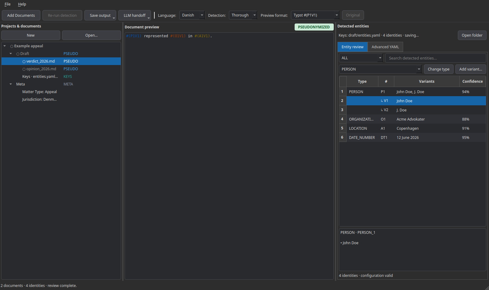

# did

**Aim.** Local-first review and pseudonymization of identity-bearing documents so a human can correct detection, and a remote model never sees the source.

**Use.** `did extract` finds entities into a YAML map; you review and fix that map; `did anon` applies it and emits pseudonymized documents into one output folder, or a token-only Markdown/JSON/ZIP handoff. `did anon --pdf` compiles a placeholder PDF per document (labels such as `[PERSON 1]`, never the real values) for an ordinary `evid doc add`. Placeholders like `#(P1V1)` / `#(P1V2)` are the same person, two written forms.

**Features.**
- CLI + GUI over one on-disk case workdir (mutable draft, one rewritten output)
- Entity review: type correction, aliases, identity merge, persistent exclusions
- Searchable preview, clickable keys, manual labelling
- PDF / DOCX / Markdown / plain-text and other text formats extraction
- Advisory sweep that re-scans for identifiers that survived replacement (an aid to review, not a verdict)
- Placeholder-PDF handoff (`did anon --pdf`): PDFs only, no key set, ready for `evid doc add`
- Faker identities, or irreversible `[REDACTED]`

## GUI



## Install

Python 3.12+, [uv](https://docs.astral.sh/uv/). The GUI is part of the base install: a local page on 127.0.0.1, shown in the `did-app` window when that binary is built, otherwise in the browser. Language models are an extra.

```bash
uv tool install 'did[models] @ git+https://github.com/evidlabel/did.git'   # CLI + spaCy models
uv tool install 'did[all] @ git+https://github.com/evidlabel/did.git'      # same, plus every model
did --help
did gui                 # did-app window, or the browser if it is not built
did gui --browser       # always the browser
did gui --agent ''      # Agent pane starts a shell instead of OpenCode
did models da           # fetch only the models a language needs (here Danish + English)
```

`did[gui]` is an empty extra so older install lines keep resolving. A second `did gui` raises the running window. In a checkout, `make tool` reinstalls this tree as the `did` tool and puts `did-app` on PATH. `make app-build` builds the window only.

The review window has an agent pane on the right. With a project open it starts a shell in that project's folder and types `ocprofile launch local-qw38` (local Qwen for both plan and write). The other local pairings are in the pane's list. `ocprofile launch` does not change the saved OpenCode profile. `$DID_AGENT` or `did gui --agent` replaces the command; an empty command starts a shell. Selection types the pseudonymized preview into the terminal. Original text stays on this machine. Check pseudonymization →, on the identity list, sends the keyword YAML to that local agent so it can look for non-PII to remove and entries to combine. That YAML is not part of the remote handoff.

The preview shows a document as soon as its text has been read. Until detection finishes, the badge says UNANON and the text is the source. That view stays on this machine: Selection and the handoff wait for the pseudonymized text. Unchanged documents stay cached for the rest of the GUI session, so opening them again does not wait on extraction or detection.

Missing models never block you. The GUI downloads the model for a document's
language the first time you detect in it, and `did models [da en sv]` installs
them ahead of time. Only the missing model wheels are installed; no other
package changes. In a checkout, `make models` does the same.

## Development

```bash
uv sync --all-extras
uv run pytest -v
```

## Disclaimer

Automated detection is not a guarantee of anonymity. Review before sharing.

## License

License: [MIT](LICENSE). CLI: `did -h`. Agents: [`SKILL.md`](SKILL.md).
